<!-- animated contribution graph: real data, boxes reveal cell by cell
     (regenerated daily by .github/workflows/update-profile-art.yml) -->

<h3><code>umrzoq@github ~ $ ./contributions.sh</code></h3>

 
 

<!-- ascii portrait (left) + streak/numbers card (right). both svgs are
     840x880 so equal widths give equal heights.
     portrait: python scripts/prep_photo.py && python scripts/make_ascii_svg.py
     stats:    python scripts/render_stats_svg.py (same daily workflow) -->

<h3><code>umrzoq@github ~ $ whoami</code></h3>

<table>
<tr>
<td valign="top"></td>
<td valign="top"></td>
</tr>
</table>

 
 

<h3><code>umrzoq@github ~ $ ./links.sh</code></h3>

<b>Data Science Student @ School 21 · AI & Python Backend Developer</b>

 

---

### 👨‍💻 About Me

> **"Data Science student and Python Backend developer driven by algorithmic problem-solving, machine learning models, and reliable systems."**

- 🎓 **Education:** Data Science student at **School 21 Uzbekistan (42 Network)** — completed **40+ practical coursework** and rigorous peer-to-peer projects.
- ⚙️ **Backend:** Graduated from **Mohirdev's Python Backend** program (Python, Django, FastAPI, relational databases, clean architecture).
- 🧠 **Machine Learning:** Working with supervised learning, validation, decision trees, clustering, PCA, SVD, neural networks, CNNs, RNNs, attention mechanisms, and generative ML.
- 🤖 **AI & Systems:** Built autonomous AI agents with Linux Bubblewrap sandboxing, real-time audio streaming (Icecast2 + FFmpeg), and Telegram bots.
- 🌱 **Current Goal:** Actively seeking a **Data Science / Machine Learning Internship** to apply algorithmic and backend engineering skills to real-world problems.

---

### 🛠 Tech Stack

#### 📊 Data Science & Machine Learning

  

#### ⚙️ Backend & Databases

  

#### 🧰 Tools & Environment

  

---

### 🚀 Selected Projects

- 🎙 **[INTRA GROUP - AI Radio Platform](https://github.com/Umrzoq-backend-ai/Intra_group_bot)**  
  Telegram Mini App with FastAPI, Gemini AI integration, PostgreSQL, WebSocket real-time chat, and Icecast2 live audio streaming.

- 🤖 **[Tahlilchi-Ai](https://github.com/Umrzoq-backend-ai/Tahlilchi-Ai)**  
  Autonomous Data Analyst AI agent featuring Linux Bubblewrap sandbox execution, Gemini planner/repair loops, and AST validation.

- 📡 **[School 21 Monitoring Bot](https://github.com/Umrzoq-backend-ai/k2monitoring)**  
  Python systemd daemon tracking campus clusters with automatic OAuth token refresh, logging, and instant Telegram alerts.

- 🌐 **[Personal Portfolio](https://github.com/Umrzoq-backend-ai/my_portfolio2)**  
  Responsive portfolio application showcasing technical journey, machine learning coursework, and backend systems.
