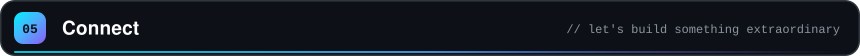

 

 

 

<!-- ═══════════════════════════ 01 ABOUT ═══════════════════════════ -->

 

### Architecting autonomous AI agents, intelligent data pipelines & high-concurrency systems.

I build resilient backend systems and machine learning workflows that operate at production scale. 
Specialized in **autonomous LLM agents** with zero-privilege sandboxed execution (**Linux Bubblewrap**, AST verification), 
real-time streaming pipelines (**WebSockets, FFmpeg, Icecast2**), and data analysis at depth.

Honing systems engineering and computational fundamentals at **School 21 (42 Network)**: 
peer-to-peer algorithms, systems programming, and high-load architecture. 
Bridging the gap between cutting-edge **Generative AI (Gemini 2.0 / 1.5 Pro)** and production-grade **FastAPI & PostgreSQL**.

🛡️ Sandboxed & Secure &nbsp;·&nbsp; ⚡ High-Concurrency &nbsp;·&nbsp; 🧠 Autonomous Agentic AI &nbsp;·&nbsp; 📊 Deterministic Analytics

 

<!-- ═══════════════════════════ 02 SKILLS ═══════════════════════════ -->

 

  

  

  

  

  

  

  
  
  
  
  

 

<!-- ═══════════════════════════ 03 FEATURED SYSTEMS ═══════════════════════════ -->

 

Source Repositories: <a href="https://github.com/Umrzoq-backend-ai/Tahlilchi-Ai">Tahlilchi-Ai</a> · <a href="https://github.com/Umrzoq-backend-ai/Intra_group_bot">Intra_group_bot</a> · <a href="https://github.com/Umrzoq-backend-ai/k2monitoring">k2monitoring</a> · <a href="https://github.com/Umrzoq-backend-ai/my_portfolio2">my_portfolio2</a>

 

<!-- ═══════════════════════════ 04 LIVE METRICS ═══════════════════════════ -->

 

  

<picture>
  <source media="(prefers-color-scheme: dark)" srcset="https://raw.githubusercontent.com/Umrzoq-backend-ai/Umrzoq-backend-ai/output/github-contribution-grid-snake-dark.svg" />
  <source media="(prefers-color-scheme: light)" srcset="https://raw.githubusercontent.com/Umrzoq-backend-ai/Umrzoq-backend-ai/output/github-contribution-grid-snake.svg" />
  
</picture>

 

<!-- ═══════════════════════════ 05 CONNECT ═══════════════════════════ -->

 

  

Engineered with precision in Tashkent · Powered by Python, Gemini & the School 21 peer-to-peer spirit.

  

